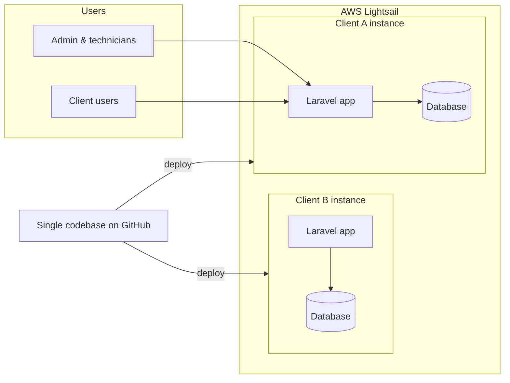

# 🛠️ Equipment & Maintenance Management SaaS — Case Study

> A web platform I designed, built and deployed **on my own** for industrial maintenance companies. It is **in production with its first client**.
> The source code is private (commercial product); this repository documents the problem, the architecture and the main technical decisions.

**Role:** Founder & sole developer (product, backend, frontend, infrastructure)
**Stack:** Laravel · PHP · Blade · Tailwind CSS · Alpine.js · SQL · AWS Lightsail

---

## 📌 The problem

Industrial maintenance companies usually track their clients' equipment, work orders and technicians in spreadsheets, paper forms and chat messages. That makes it hard to:

- Know the full history (*hoja de vida*) of every piece of equipment.
- Assign and follow up work orders and the technicians responsible for them.
- Give clients visibility of the work done on their equipment.
- Produce reports for management and for the client.

## ✅ The solution

A single platform with two portals:

| Admin portal (maintenance company) | Client portal (their customers) |
|---|---|
| Manage clients, equipment and equipment categories | See their own equipment and its history |
| Create, assign and track work orders | Follow the status of their work orders |
| Manage technicians and their assignments | See the technicians assigned to their equipment |
| Generate PDF and Excel reports | Download the reports they are allowed to see |

**Core modules:** clients · equipment & categories · work orders · technicians · reports · users, roles & permissions.

## 🏗️ Architecture

- **Monolith in Laravel** with server-rendered Blade views, Tailwind CSS and Alpine.js for interactivity. Fast to build and easy to maintain as a solo developer.
- **Role-based access control** with `spatie/laravel-permission`: admins, technicians and client users each see only what they are allowed to.
- **Reports** generated as PDF (`barryvdh/laravel-dompdf`) and Excel (`maatwebsite/excel`).
- **Silo deployment model:** one isolated instance and database per client on AWS Lightsail.

## 🧠 Key technical decisions

### 1. One instance per client (silo) instead of multi-tenant
**Why:** strong data isolation between companies, simpler security reasoning, and the ability to customize or scale a single client without affecting the others.
**Trade-off:** more operational work per client (deploys, backups, monitoring), accepted in exchange for isolation. All instances run the same codebase, so every client gets the same version.

### 2. Laravel monolith + Blade instead of SPA
**Why:** one codebase, fewer moving parts and faster delivery for a one-person team. Alpine.js covers the interactive parts without a separate frontend build.

### 3. AWS Lightsail instead of a more complex AWS setup
**Why:** predictable monthly cost per client, which makes pricing the SaaS straightforward, while keeping the option to move to EC2/RDS as clients grow.

### 4. Delivered in phases
The project followed an incremental plan: requirements validation first, then modules delivered and validated by the client one by one.

## 📈 Status & next steps

- ✅ In production with the first client
- 🔜 Onboarding more maintenance companies in Colombia
- 🔜 Screenshots and a demo with sample data

## 👋 About me

I'm **Wilman Zuleta**, a Full-Stack Developer from Santa Marta, Colombia, working with Laravel, React and AWS.

